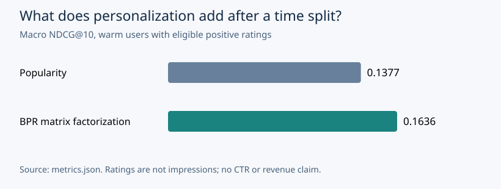

# Temporal Recommendations

**Does personalization still help when every interaction from the future is off limits?**

An original PyTorch recommender experiment by Vedant Thaker. I compare a popularity baseline with pairwise matrix factorization, then require both to rank the same full catalog under the same global-time boundary. The output is a model decision supported by reproducible evidence, with cold-start exclusions and coverage visible.

This is new independent portfolio research. It demonstrates recommendation engineering and evaluation practices; it is not employer code, a historical client deployment, or proof of previous workplace metrics.

## Start with the evidence

- [Read the generated case study](reports/case-study.md): problem, alternative, framework, actual results and decision.
- [Inspect the numerical source of truth](reports/metrics.json).
- [Check the data card and licensing boundary](DATA_CARD.md).
- [Review the tests](tests/test_temporal_recommendations.py).



## Run it

Python 3.11, CPU, no API key or GPU required. The committed run used NumPy 1.26.0 and PyTorch 2.9.1+cpu with two CPU threads.

```bash
python -m venv .venv
# Windows: .venv\Scripts\activate
# macOS/Linux: source .venv/bin/activate
python -m pip install -r requirements.txt
python -m unittest discover -s tests -v
```

After reading the [GroupLens research-use terms](https://files.grouplens.org/datasets/movielens/ml-100k-README.txt):

```bash
python run.py --download --benchmark
```

The download is approximately 5 MB. It stays under ignored `data/raw/`; raw ratings are not redistributed. The downloader checks the pinned archive SHA-256, extracts only the expected ratings member, and rejects duplicates/invalid ratings. If a managed Windows Python installation lacks the relevant trusted CA, use the operating system's verified HTTPS stack rather than disabling certificate verification:

```powershell
New-Item -ItemType Directory -Force data/raw | Out-Null
Invoke-WebRequest -Uri https://files.grouplens.org/datasets/movielens/ml-100k.zip -OutFile data/raw/ml-100k.zip
python run.py --download --benchmark
```

No-network smoke run on the original fixture:

```bash
python run.py --benchmark --data data/fixture.tsv --output artifacts/fixture-run
```

`reports/metrics.json`, `reports/per_user_test.csv`, `reports/ranking.svg` and `reports/case-study.md` are generated together. Re-running replaces them with the new run; measured runtime may change with hardware and load. Keep fixture outputs separate from the real-data report.

To regenerate the story and charts from the saved numerical evidence without fitting models again:

```bash
python render_report.py
```

## The experiment contract

| Choice | Implementation |
|---|---|
| Decision | Does BPR warrant further offline validation against popularity? |
| Grain | One user-item rating; duplicates are rejected |
| Split | Global timestamps: first ~70% train, next ~15% validation, final ~15% test; timestamp ties stay together |
| Positive | Rating >=4 |
| Candidate universe | Every item observed in training, minus the user's previous ratings |
| Selection | Validation macro NDCG@10 chooses 16 or 32 factors; seed 42, 16 epochs, learning rate .02 |
| Test | Frozen training model; exclude training and validation history; full eligible catalog, no evaluation negative sampling; warm means at least one positive training rating |
| Measures | Macro Recall@10 and NDCG@10, catalog coverage, positive-target coverage, cold-start exclusions |
| Secondary system audit | Frozen selected model for warm users, popularity fallback for users without positive training signal; explicitly labeled as an audit-driven diagnostic |
| Uncertainty | Paired bootstrap over observed test users, not over training runs or future populations |

The learned model is deliberately small. Its purpose is to make the protocol inspectable before introducing more complex sequential models, embedding services or ANN infrastructure. A stronger architecture would still have to satisfy the same temporal and candidate contracts.

## How this relates to my engineering work

This project demonstrates skills relevant to client-facing recommendation and ranking work: translating a vague request into a decision contract, building a transparent baseline, implementing a trainable model, defining eligible populations, detecting leakage risks, and communicating what the result does and does not support. Its public dataset and experiment are separate from any private company data or business results.

## Inspiration and attribution

[Build Your Own X](https://github.com/codecrafters-io/build-your-own-x) inspired the approach of learning a system by implementing its core. This project uses that direction rather than copying a tutorial. The code, fixture, evaluation protocol and report generator are original for this portfolio. The BPR objective is credited to [Rendle et al., UAI 2009](https://arxiv.org/abs/1205.2618); the dataset is credited to GroupLens under its separate terms.
