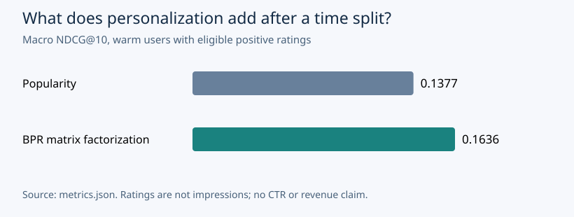
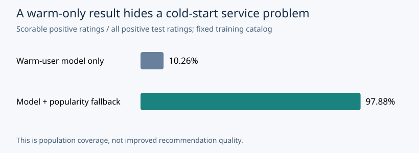

# Popularity and personalized ranking on MovieLens 100K

MovieLens ratings record preferences among rated items. They provide no impression logs or online engagement outcomes.

The first comparison covers 51 warm users. It scores 869 of 8,471 held-out positive ratings. That second count matters when choosing a serving policy: a strong list for a known user does little for someone with no trained user factor.

## Ranking the same catalog

One global clock partitions the ratings into 70,001 training, 14,999 validation and 15,000 test rows. Rows at the same timestamp stay together. Each test list comes from the 1,573 training-catalog items, excluding titles that user rated during training or validation. Both models score the full eligible catalog. Four- and five-star ratings count as positive.

Popularity ranks by positive training count. Bayesian personalized ranking (BPR) learns user and item factors from pairwise comparisons during training. Validation NDCG@10 selected 32 factors. Its weights stay fixed for the test window.

| Warm-user test measure | Popularity | BPR |
| --- | ---: | ---: |
| NDCG@10 | 0.1377 | 0.1636 |
| Recall@10 | 7.21% | 8.73% |
| Share of catalog appearing in top-ten lists | 4.58% | 18.88% |

Each user contributes equally to recall and NDCG. The paired difference in NDCG@10 (BPR minus popularity) was **+0.0259**, with a 95% user-bootstrap interval of **[-0.0196, +0.0664]**. The interval includes zero. These users and this split leave the ranking advantage unresolved. Resampling users holds the fitted weights and the time window fixed. [Paired scores](per_user_test.csv)

## Serving a user with no positive training rating

The warm-user evaluation excluded 156 users with no positive training signal and 5 additional warm users whose positive targets were unavailable. A second pass uses the same BPR weights for warm users and a popularity list for cold users. New titles outside the training catalog remain ineligible.

| System comparison | Saved result |
| --- | ---: |
| Users with an eligible test target | 206 |
| Of those, users served by the cold-user fallback | 155 |
| Positive ratings eligible under the hybrid | 8,291 / 8,471 (97.88%) |
| Popularity NDCG@10 on this population | 0.2688 |
| Hybrid NDCG@10 on this population | 0.2752 |
| Paired hybrid minus popularity, 95% interval | +0.0064 [-0.0051, +0.0178] |

The change from 10.26% to 97.88% describes **coverage of held-out positive ratings**. Ranking quality needs a comparison on matched users. This broader pass was added after inspecting the original coverage, so its ranking result is exploratory. [Per-user system comparison](per_user_system_test.csv)

The [saved metrics](metrics.json) contain the timestamp cutoffs, input digest, validation runs and training losses. The study uses the [GroupLens MovieLens protocol and data terms](https://grouplens.org/datasets/movielens/100k/) for the public dataset and the [BPR objective](https://arxiv.org/abs/1205.2618). [Build Your Own X](https://github.com/codecrafters-io/build-your-own-x) provided the original learning-by-building reference. This is an independent offline experiment by Vedant Thaker.
