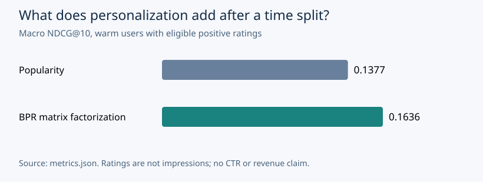
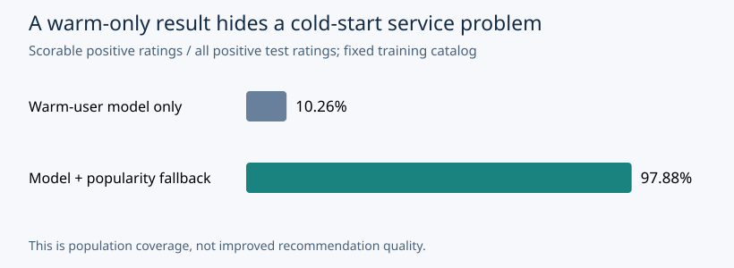

# Temporal Recommendations: earn the right to personalize

**Independent portfolio research by Vedant Thaker.** This implementation was built for this public portfolio. It is not a reconstruction of any employer or client system, and its metrics do not substantiate historical workplace claims.

## A ranked list is a decision, not just a model score

Recommendation systems turn a long catalog into a short list. Matrix factorization is one way to personalize that list. Before adding that complexity, I wanted to answer a narrower question: does a model trained only on the past rank later positive ratings better than a simple popularity baseline?

The recommendation from this run is: **Keep popularity as the default while collecting stronger evidence for personalization.**

Three pieces of calculated evidence frame that decision:

1. On the same 51 eligible test users, popularity reached NDCG@10 **0.1377** and BPR reached **0.1636**.
2. Recall@10 was **7.21%** for popularity and **8.73%** for BPR. These are macro averages over users, not the fraction of all ratings recovered.
3. The training catalog and warm-user requirement covered only **10.26%** of positive test ratings. An audit-driven popularity fallback made **97.88%** of positive test ratings scorable under the same training-catalog policy. These are different evaluation populations; that coverage change is not a model-quality lift.

## The conventional shortcut hides two different problems

A random row split can let a model learn from an interaction that occurred after the event it is meant to predict. Sampling a few easy negatives at evaluation can also turn a large-catalog ranking problem into a much easier test. Those are protocol risks, not claims that every conventional recommender makes those mistakes.

I addressed them directly: one global clock splits all users' events into train, validation and test; evaluation scores the full eligible training catalog. I do not compare these temporal results with an easier random-split or sampled-negative number. That comparison would mix model quality with evaluation design.

## My framework: clock, catalog, candidates, comparison

**Clock.** The observed training window ends at Unix timestamp 887039271; validation ends at 891036414. Equal timestamps remain together. The partitions contain 70,001, 14,999 and 15,000 ratings. The model is frozen after training; validation selects between two factor counts. Test is evaluated after that selection.

**Catalog.** Every candidate item existed in training. Users without positive training signal and test-only items are measured as coverage limitations, rather than silently granted embeddings learned from future rows.

**Candidates.** A positive means a rating of 4 or 5; a warm user has at least one positive training rating. Users with only low training ratings take the fallback because BPR has not learned their user factor. At validation, every prior training rating is excluded from recommendations. At test, training and validation histories are excluded. Every model sees the same candidate universe and eligible users. There are no randomly sampled negatives in evaluation. During BPR training only, one unobserved/non-positive training-catalog item is sampled per positive per epoch; future ratings are not consulted. A missing rating is not evidence of dislike.

**Comparison.** Popularity counts positive training ratings. The PyTorch model learns user/item factors and item bias using pairwise BPR loss. I predeclared 16 and 32 factors, 16 epochs, learning rate 0.02 and seed 42. Validation NDCG@10 selected **32 factors**; no test metric selected the model. Both experiments and their loss curves are in `metrics.json`.

## The result includes the downside

| Offline measure | Popularity | BPR |
|---|---:|---:|
| NDCG@10 | 0.1377 | 0.1636 |
| Recall@10 | 7.21% | 8.73% |
| Recommended catalog coverage | 4.58% | 18.88% |
| Evaluated users | 51 | 51 |

The paired bootstrap difference in NDCG@10 (BPR minus popularity) is **+0.0259**, with a user-resampling 95% interval of **[-0.0196, +0.0664]**. This interval describes variation across the observed eligible users. It does not include retraining uncertainty, time-window selection, future drift or generalization to another product.

This run excluded 156 test users with positive ratings because they had no positive training signal, plus 5 warm users without an eligible positive item. I would retain popularity for cold-start fallback, then evaluate that fallback on an explicitly defined new-user population before rollout.

## The denominator audit changed the system I needed to evaluate

The first warm-only result was too narrow to describe a whole recommendation service. That was an observed finding, not an assumed benefit of personalization. I added a secondary evaluation after that coverage audit: keep the selected BPR model frozen, and return the training popularity ranking for users without a learned user factor. No factor count, epoch count, learning rate, or model weight was retuned using test results.

In this offline pass, the hybrid ranked candidates for 206 eligible test users, including 155 cold users. Its NDCG@10 was **0.2752**, against **0.2688** for popularity on that same broader population. The paired NDCG difference was **+0.0064**, with a user-bootstrap 95% interval **[-0.0051, +0.0178]**. Treat this as a labeled diagnostic system comparison, not an independent confirmatory experiment. The next run should declare this complete system policy before looking at its test window.

The fallback makes more requests scorable; it does not establish that recommendations helped those users. Test-only items remain unavailable. This distinction is why I report ranking quality and population coverage separately.

## What impact can I defend?

The implemented value is a reproducible release decision: a baseline, a personalized alternative, consistent candidates, a temporal boundary, and evidence that can be rerun. The benchmark measures offline ranking on historical MovieLens ratings. It does **not** measure online CTR, session time, retention, revenue, fraud capture or a causal business effect. MovieLens ratings are selected observations, not exposure logs; unrated movies are not verified negatives.

The principal tradeoff is added training and maintenance complexity against the observed ranking difference. The next checkpoint is another predeclared time window, more training seeds, cold-start evaluation and, if a real product is available, a guarded randomized online experiment with engagement and coverage metrics. I would change the decision if that evidence reverses the observed advantage or exposes unacceptable cold-start or catalog-concentration behavior.

## Evidence and sources

- All quoted experiment values are calculated from `metrics.json`; `per_user_test.csv` contains the paired per-user measures with neutral row IDs. No original rating rows are redistributed.
- The original problem and implementation are authored for this portfolio. [Build Your Own X](https://github.com/codecrafters-io/build-your-own-x) supplied the learning-by-building direction; no tutorial code or published tutorial result was copied.
- GroupLens Research, [MovieLens 100K](https://grouplens.org/datasets/movielens/100k/) and [usage terms](https://files.grouplens.org/datasets/movielens/ml-100k-README.txt).
- F. Maxwell Harper and Joseph A. Konstan (2015), *The MovieLens Datasets: History and Context*, [doi:10.1145/2827872](https://doi.org/10.1145/2827872).
- Steffen Rendle et al. (2009), *BPR: Bayesian Personalized Ranking from Implicit Feedback*, [arXiv:1205.2618](https://arxiv.org/abs/1205.2618). The implementation here is original.
